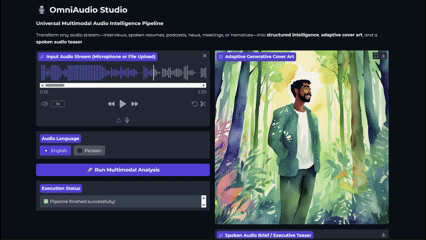

# 🎙️ OmniAudio Studio: Universal Multimodal Intelligence Pipeline

[](https://www.python.org/)
[](https://opensource.org/licenses/MIT)
[](https://gradio.app/)
[](https://pytorch.org/)
[](https://developer.nvidia.com/cuda-toolkit)

An enterprise-grade, edge-deployable, multimodal audio intelligence workstation. OmniAudio Studio converts arbitrary audio streams—spoken resumes, executive meetings, investigative journalism, narratives, academic lectures, or tech briefings—into **structured semantic dossiers**, **genre-adaptive 8K visual artwork**, and **low-latency** spoken executive **audio teasers**.

The system dynamically adapts to content topology across both **English** and **Persian (Farsi)** without architectural reconfiguration, operating within consumer-grade VRAM constraints via sequential phase orchestration and 4-bit Quantization (QLoRA NF4).

---

## 🏗️ System Architecture

```text
                                  +--------------------------+
                                  |    Raw Audio Stream      |
                                  | (Microphone / File Upload|
                                  +------------+-------------+
                                               |
                                               v
                                  +--------------------------+
                                  | Gradio Reactive UI / API |
                                  | (Dual-Language Selector) |
                                  +------------+-------------+
                                               |
                          +--------------------+--------------------+
                          | [En Route]                              | [Fa Route]
                          v                                         v
       +------------------------------------+    +------------------------------------+
       | Phase 1A: Whisper ASR (Small.en)   |    | Phase 1B: Whisper ASR (Medium)     |
       | Transcribe + Timestamps + Chunking |    | Transcribe + Persian Native Tokens |
       +------------------+-----------------+    +------------------+-----------------+
                          |                                         |
                          +--------------------+--------------------+
                                               |
                                 [gc.collect() + empty_cache()]
                                               |
                                               v
                          +-----------------------------------------+
                          | Phase 2: Domain-Agnostic LLM Engine     |
                          | (4-bit NF4 Quantization / BitsAndBytes) |
                          |                                         |
                          |  • EN: meta-llama/Llama-3.2-1B-Instruct |
                          |  • FA: Qwen/Qwen2.5-3B-Instruct         |
                          +--------------------+--------------------+
                                               |
               +-------------------------------+-------------------------------+
               |                               |                               |
               v                               v                               v
    +--------------------+           +-------------------+           +-------------------+
    | Structured Dossier |           | Audio Teaser Text |           | Dynamic Visual    |
    | (Markdown Insights)|           | (Single Sentence) |           | Prompt (English)  |
    +--------------------+           +---------+---------+           +---------+---------+
                                               |                               |
                                 [gc.collect() + empty_cache()]  [gc.collect() + empty_cache()]
                                               |                               |
                                               v                               v
                                     +-------------------+           +-------------------+
                                     | Phase 3: TTS      |           | Phase 4: Vision   |
                                     | • EN: SpeechT5    |           | • Segmind SSD-1B  |
                                     | • FA: VITS (MMS)  |           | • SDXL Distilled  |
                                     +---------+---------+           +---------+---------+
                                               |                               |
                                               +---------------+---------------+
                                                               |
                                                               v
                                              +---------------------------------+
                                              | Unified Multimodal Deliverable  |
                                              | (Dossier + Cover Art + Spoken)  |
                                              +---------------------------------+
```

## 📷 Screen Shot


## 🌟 Technical Highlights

- **Bilingual & Domain-Agnostic Processing**: Automatically identifies arbitrary content categories (personal resumes, tech discussions, narratives, broadcast news) and adjusts the output structure accordingly.
- **Dynamic Multi-Engine LLM Routing**: 
  - Uses **`Llama-3.2-1B-Instruct`** for ultra-fast, low-footprint English reasoning.
  - Switches to **`Qwen2.5-3B-Instruct`** for flawless Persian grammar, deep semantic extraction, and multi-lingual comprehension.
- **Aggressive VRAM Optimization**: Executes 4 deep neural networks sequentially on a single consumer GPU by utilizing **4-bit NF4 Quantization** (via `bitsandbytes`) and deterministic GPU memory flushing (`gc.collect()` and `torch.cuda.empty_cache()`) between pipeline phases.
- **Adaptive Visual Generation**: The LLM synthesizes a highly contextualized English prompt based on the audio's genre, which is then rendered by the **`segmind/SSD-1B`** diffusion model (a highly distilled version of SDXL) to generate genre-specific 8K cover art without cache conflicts.
- **Multimodal Feedback Loop**: Generates a fast-paced, single-sentence executive audio teaser using `microsoft/speecht5_tts` (English) or `facebook/mms-tts-fas` (Persian) natively mapped to GPU for near real-time synthesis.

---

## 📂 Repository Layout

```text
├── core.py                    # The AI Pipeline: Whisper, LLM inference, TTS, and Diffusion logic
├── app.py                     # Gradio Blocks UI presentation layer and state management
├── requirements.txt           # Production environment pinned dependencies
├── .env.example               # Environment configuration template for Hugging Face tokens
└── README.md                  # Comprehensive architectural and setup documentation
```

---

## 🛠️ Tech Stack & Dependencies

| Layer | Technology | Usage |
| --- | --- | --- |
| **Speech-to-Text (ASR)** | `openai/whisper` | Chunked audio transcription (`small.en` / `medium`) |
| **Foundational LLMs** | Llama 3.2 (1B), Qwen 2.5 (3B)| Content classification, summarization, prompt synthesis |
| **Quantization** | `bitsandbytes`, `accelerate` | 4-bit NF4 double-quantization for low-VRAM inference |
| **Vision/Image Gen** | `diffusers` (SSD-1B) | Distilled SDXL for rapid, adaptive cover art generation |
| **Text-to-Speech (TTS)** | `SpeechT5`, `VITS` | GPU-accelerated localized voice generation |
| **User Interface** | Gradio Blocks (`>=4.0.0`) | Event-driven reactive web UI |

---

## 🚀 Step-by-Step Installation

### Prerequisites
* Python `3.10` to `3.12` installed.
* An active NVIDIA GPU (Minimum 6GB-8GB VRAM recommended).
* A Hugging Face account and Access Token (for downloading gated models like Llama 3.2).

### 1. Local Environment Configuration

```bash
# Clone the repository
git clone https://github.com/imehranasgari/OmniAudio-Studio.git
cd OmniAudio-Studio

# Provision virtual environment (using standard venv or uv)
python -m venv .venv

# Activate environment
# On Windows:
.venv\Scripts\activate
# On Linux/macOS:
source .venv/bin/activate
```

### 2. Install PyTorch with CUDA Support (Crucial for GPU Acceleration)
To ensure the pipeline runs on the GPU, install the specific PyTorch wheel for your CUDA version (e.g., CUDA 12.4):
```bash
pip install torch torchvision torchaudio --index-url https://download.pytorch.org/whl/cu124
```

### 3. Install Remaining Dependencies
```bash
pip install -r requirements.txt
```
*(Note: If the `sentencepiece` error occurs during TTS, ensure it is installed via `pip install sentencepiece`)*

### 4. Environment Variables
Create your local environment file to authenticate with Hugging Face:
```bash
cp .env.example .env
```
Populate `.env` with your API configuration:
```env
HF_TOKEN=hf_YourHuggingFaceTokenHere
```
*(Make sure you have accepted the user agreement for Llama 3.2 on the Hugging Face website).*

### 5. Execution
```bash
python app.py
```
Access the application dashboard at `http://127.0.0.1:7862`.


## 👤 Author & Maintainer

**Mehran Asgari Roozbahani**

* **GitHub**: [@imehranasgari](https://github.com/imehranasgari)
* **Specialization**: Machine Learning Pipelines, MLOps, LLM Systems & Multimodal AI


## 📄 License

This project is licensed under the [MIT License](LICENSE).